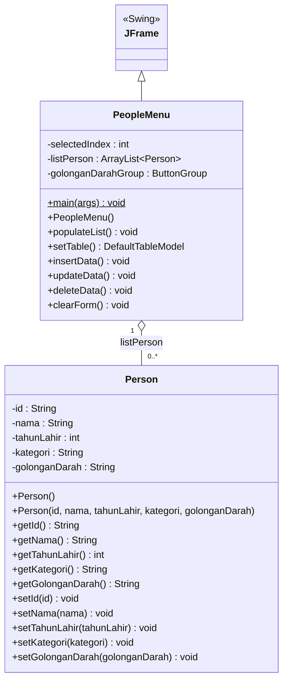
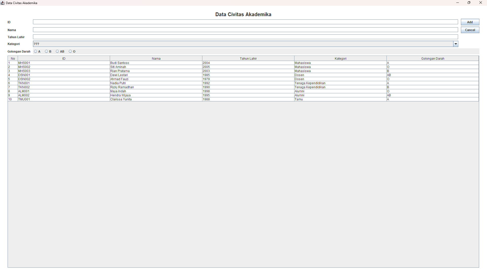
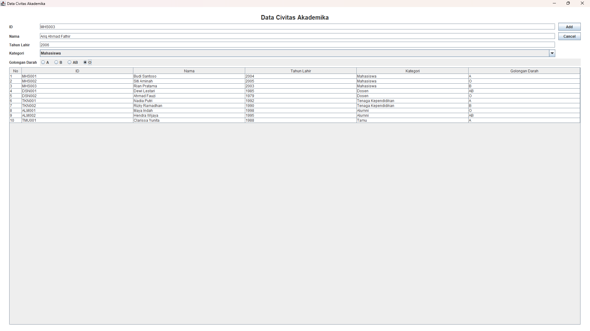
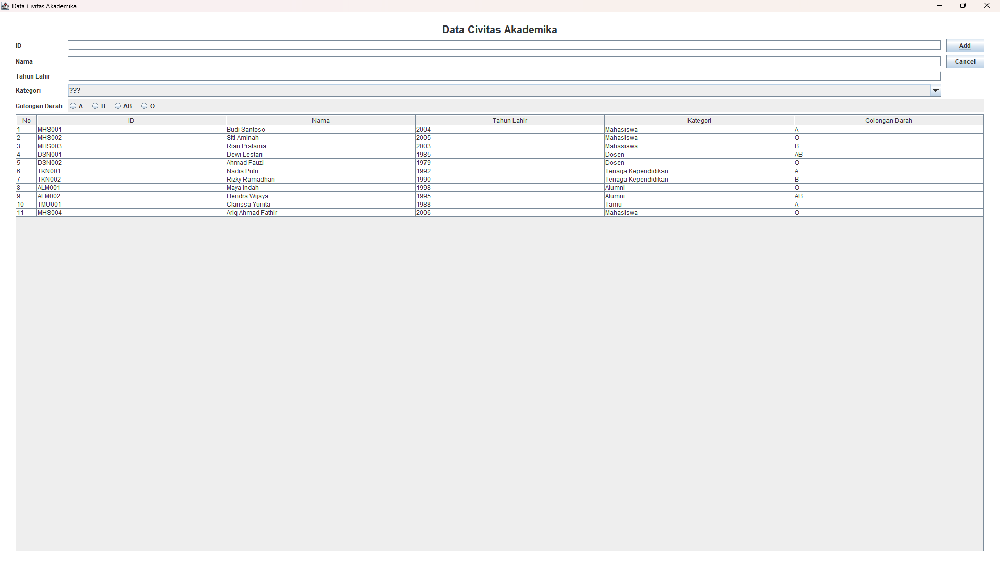
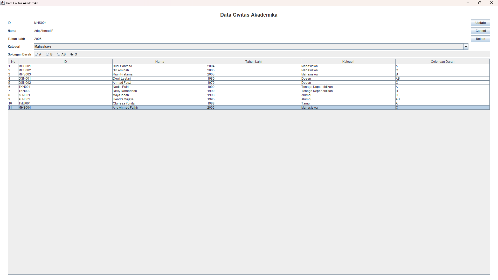
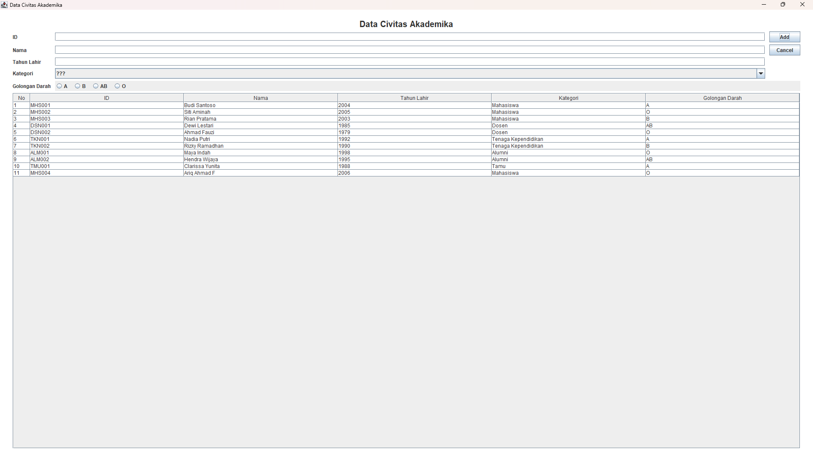
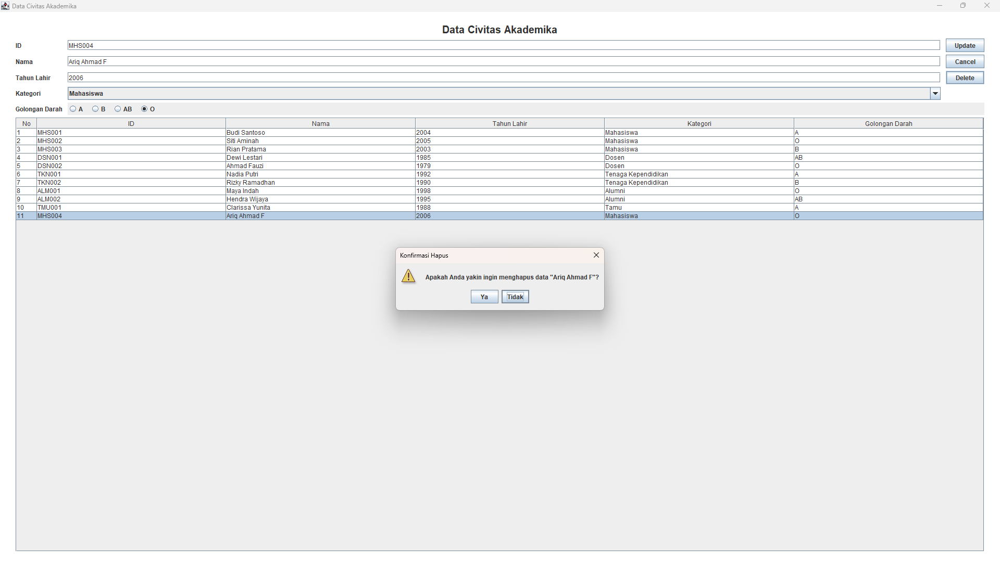
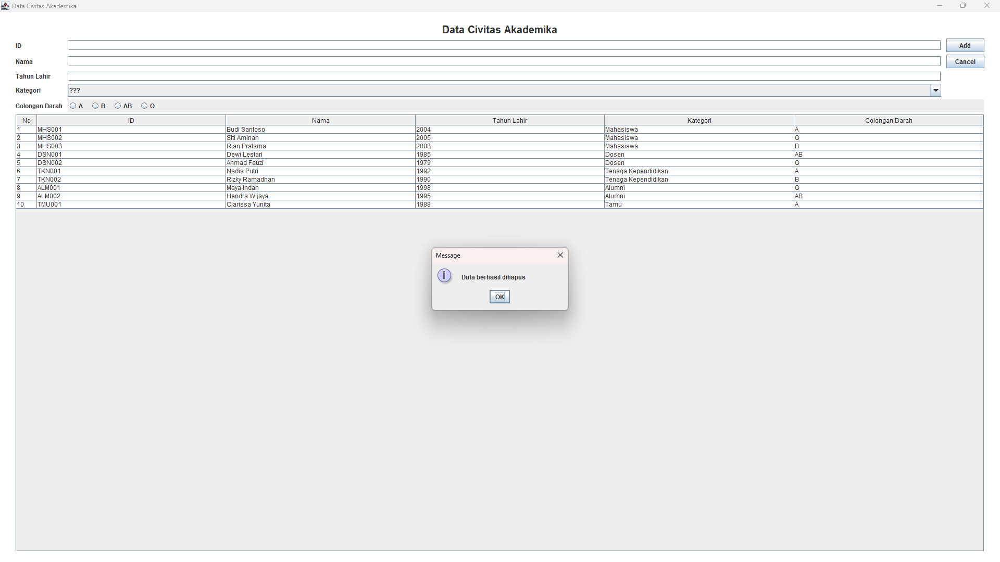
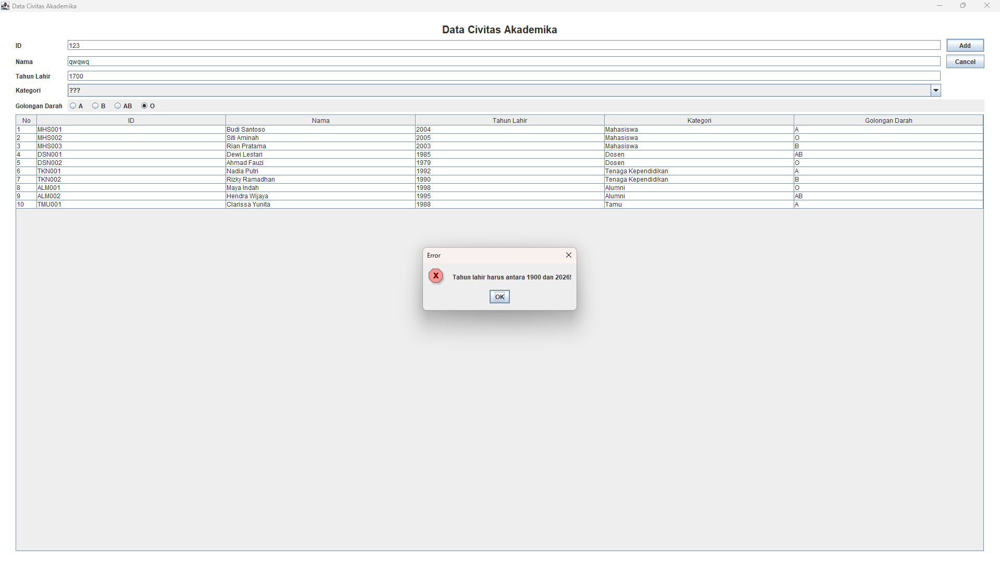

# TP4 DPBO - PeopleData (Java Swing GUI, CRUD Data Civitas Akademika)

Nama : Ariq Ahmad Fathir
NIM : 2506752
Kelas : C2

## Janji

Saya Ariq Ahmad Fathir dengan NIM 2506752 mengerjakan TP 4 dalam mata kuliah
Desain dan Pemrograman Berorientasi Objek untuk keberkahan-Nya, maka saya tidak melakukan
kecurangan seperti yang telah dispesifikasikan. Aamiin.

## Tentang Programnya

Program ini adalah aplikasi desktop **Java Swing GUI** untuk mengelola **data civitas akademika**
(mahasiswa, dosen, tenaga kependidikan, alumni, dan tamu). Semua operasi **CRUD** dapat dilakukan
lewat satu jendela: **C**reate (tambah data), **R**ead (tampil di tabel), **U**pdate (ubah data),
dan **D**elete (hapus data). Data disimpan sementara di dalam `ArrayList<Person>` (tanpa database),
dan diisi data awal lewat method `populateList()`.

Struktur kodenya mengikuti latihan ProductData, dengan tema **People**:

| Latihan (ProductData) | Tugas (PeopleData) |
| --------------------- | ------------------ |
| `Product.java`        | `Person.java`      |
| `ProductMenu.java`    | `PeopleMenu.java`  |
| `ProductMenu.form`    | `PeopleMenu.form`  |

Yang dikerjakan sesuai spesifikasi tugas:

1. Tema People dengan **4 atribut awal**: ID, Nama, Tahun Lahir, Kategori.
2. **Confirmation prompt** sebelum data dihapus.
3. **Atribut baru: Golongan Darah** (`golonganDarah`), ditambahkan di class `Person`, di form, dan di
   logika `PeopleMenu.java`. Component barunya berupa **`JRadioButton`** (bukan `JTextField`), sehingga
   memenuhi **BONUS (+20)**.

## Penjelasan Atribut dan Method

### Class `Person` (`Person.java`)

Model data satu orang.

| Atribut         | Tipe   | Keterangan                                                        |
| --------------- | ------ | ----------------------------------------------------------------- |
| `id`            | String | ID unik orang (misal `MHS001`)                                    |
| `nama`          | String | Nama lengkap                                                      |
| `tahunLahir`    | int    | Tahun lahir                                                       |
| `kategori`      | String | Kategori: Mahasiswa, Dosen, Tenaga Kependidikan, Alumni, Tamu     |
| `golonganDarah` | String | **Atribut baru**: A, B, AB, atau O (dipilih lewat `JRadioButton`) |

| Method                                                                           | Keterangan                       |
| -------------------------------------------------------------------------------- | -------------------------------- |
| `Person()`                                                                       | Constructor kosong               |
| `Person(id, nama, tahunLahir, kategori, golonganDarah)`                          | Constructor dengan semua atribut |
| `getId()`, `getNama()`, `getTahunLahir()`, `getKategori()`, `getGolonganDarah()` | Getter tiap atribut              |
| `setId()`, `setNama()`, `setTahunLahir()`, `setKategori()`, `setGolonganDarah()` | Setter tiap atribut              |

### Class `PeopleMenu` (`PeopleMenu.java`, extends `JFrame`)

Class utama yang berisi tampilan dan seluruh logika program.

| Atribut                                                                                                     | Tipe                      | Keterangan                                                      |
| ----------------------------------------------------------------------------------------------------------- | ------------------------- | --------------------------------------------------------------- |
| `selectedIndex`                                                                                             | int                       | Index baris yang dipilih, `-1` berarti tidak ada yang dipilih   |
| `listPerson`                                                                                                | `ArrayList<Person>`       | Menampung seluruh data person                                   |
| `golonganDarahGroup`                                                                                        | `ButtonGroup`             | Memastikan hanya satu radio button golongan darah yang terpilih |
| `mainPanel`, `titleLabel`, `idLabel`, `namaLabel`, `tahunLahirLabel`, `kategoriLabel`, `golonganDarahLabel` | `JPanel` / `JLabel`       | Panel utama dan label tampilan                                  |
| `idField`, `namaField`, `tahunLahirField`                                                                   | `JTextField`              | Input ID, nama, dan tahun lahir                                 |
| `kategoriComboBox`                                                                                          | `JComboBox<String>`       | Pilihan kategori                                                |
| `golonganDarahPanel`, `radioA`, `radioB`, `radioAB`, `radioO`                                               | `JPanel` / `JRadioButton` | Pilihan golongan darah (atribut baru)                           |
| `addUpdateButton`                                                                                           | `JButton`                 | Tombol **Add** (mode tambah) atau **Update** (mode ubah)        |
| `cancelButton`                                                                                              | `JButton`                 | Tombol **Cancel**, mengosongkan form                            |
| `deleteButton`                                                                                              | `JButton`                 | Tombol **Delete**, hanya tampil saat ada baris yang dipilih     |
| `personTable`                                                                                               | `JTable`                  | Tabel yang menampilkan seluruh data                             |

Semua component di atas terhubung ke `PeopleMenu.form` lewat properti **field name**.

| Method                                                      | Keterangan                                                                                                                                |
| ----------------------------------------------------------- | ----------------------------------------------------------------------------------------------------------------------------------------- |
| `main()`                                                    | Membuat window, mengatur ukuran, posisi di tengah layar, content pane, warna background, dan close operation                              |
| `PeopleMenu()`                                              | Constructor: mengisi list dan tabel, mengisi combo box, membuat `ButtonGroup`, menyembunyikan tombol delete, memasang semua listener      |
| `populateList()`                                            | Mengisi 10 data awal ke `listPerson`                                                                                                      |
| `setTable()`                                                | Membuat `DefaultTableModel` dari `listPerson` (kolom No, ID, Nama, Tahun Lahir, Kategori, Golongan Darah; sel tidak bisa diedit langsung) |
| `refreshTable()`                                            | Memasang model terbaru ke `personTable` dan mengatur lebar kolom No                                                                       |
| `validasiForm(ignoreIndex)`                                 | Memeriksa isi form, mengembalikan pesan error atau `null` jika valid                                                                      |
| `getGolonganDarahTerpilih()` / `setGolonganDarahTerpilih()` | Mengambil / mengatur radio button golongan darah yang dipilih                                                                             |
| `insertData()`                                              | **Create**: validasi, tambahkan `Person` baru ke list, update tabel, bersihkan form                                                       |
| `updateData()`                                              | **Update**: validasi, ubah data `Person` pada `selectedIndex`, update tabel, bersihkan form                                               |
| `deleteData()`                                              | **Delete**: hapus data pada `selectedIndex`, update tabel, bersihkan form                                                                 |
| `clearForm()`                                               | Mengosongkan form, mengembalikan tombol ke mode "Add", menyembunyikan tombol delete, dan mengatur `selectedIndex = -1`                    |

Validasi input pada `validasiForm()`:

- ID, Nama, dan Tahun Lahir tidak boleh kosong.
- Tahun Lahir harus berupa angka bulat dan berada di antara 1900 sampai tahun sekarang.
- Kategori harus dipilih (bukan `???`).
- Golongan Darah harus dipilih.
- ID tidak boleh kembar (tidak membedakan huruf besar/kecil). Saat Update, ID milik data yang sedang diubah tidak dianggap kembar.

## Design Program

### Tampilan (`PeopleMenu.form`)

```
+--------------------------------------------------+
|              Data Civitas Akademika              |
|  ID              [______________]   [ Add/Update ]|
|  Nama            [______________]   [   Cancel   ]|
|  Tahun Lahir     [______________]   [   Delete   ]|
|  Kategori        [ ???         v]                |
|  Golongan Darah  (o)A  (o)B  (o)AB  (o)O         |
|  +--------------------------------------------+  |
|  | No | ID | Nama | Tahun Lahir | Kategori | ..|  |
|  +--------------------------------------------+  |
+--------------------------------------------------+
```

### Class Diagram



## Penjelasan Alur Program

1. Saat program dijalankan, `main()` membuat objek `PeopleMenu`. Constructor-nya mengisi `listPerson`
   dengan 10 data awal lewat `populateList()`, lalu menampilkannya di tabel lewat `setTable()`.
   Combo box diisi pilihan kategori, radio button golongan darah digabung dalam satu `ButtonGroup`, dan
   tombol **Delete** disembunyikan. Pada kondisi awal `selectedIndex = -1`, tombol berlabel **Add**.
2. **Create (tambah data)**: isi ID, Nama, Tahun Lahir, pilih Kategori dan Golongan Darah, lalu klik **Add**.
   Karena `selectedIndex == -1`, `insertData()` dipanggil. Jika input valid, data baru masuk ke
   `listPerson`, tabel diperbarui, form dikosongkan, dan muncul pesan "Data berhasil ditambahkan". Jika
   tidak valid, muncul dialog error dan data tidak ditambahkan.
3. **Read (tampil data)**: seluruh isi `listPerson` selalu ditampilkan di tabel. Saat sebuah baris
   diklik, datanya dimuat ke form, tombol berubah menjadi **Update**, dan tombol **Delete** muncul.
4. **Update (ubah data)**: setelah memilih baris, ubah isi form lalu klik **Update**. Karena
   `selectedIndex != -1`, `updateData()` dipanggil. Jika valid, data pada list diubah, tabel diperbarui,
   form dikosongkan, dan muncul pesan "Data berhasil diubah".
5. **Delete (hapus data)**: setelah memilih baris, klik **Delete**. Muncul **dialog konfirmasi**
   ("Apakah Anda yakin ingin menghapus data ...?") dengan pilihan **Ya** dan **Tidak**. Jika **Ya**,
   `deleteData()` menghapus data dari list, tabel diperbarui, dan muncul pesan "Data berhasil dihapus".
   Jika **Tidak** (atau dialog ditutup), data tidak dihapus.
6. **Cancel**: klik **Cancel** untuk mengosongkan form, mengembalikan tombol ke **Add**, dan membatalkan
   pilihan baris pada tabel.

## Cara Menjalankan

1. Buka folder `PeopleData` menggunakan **IntelliJ IDEA**.
2. Pastikan plugin **Swing UI Designer** aktif dan JDK sudah terpasang.
3. Buka `PeopleMenu.java`, lalu klik **Run 'PeopleMenu.main()'**.

> Program ini memakai GUI Form dari IntelliJ, sehingga dijalankan dari IntelliJ IDEA
> (bukan dengan `javac` biasa).

## Dokumentasi

**tampilan awal (Read)**



**tambah data sebelum (Create)**



**tambah data sesudah (Create)**



**ubah data sebelum (Update)**



**ubah data sesudah (Update)**



**konfirmasi sebelum hapus (Delete)**



**setelah data dihapus (Delete)**



**validasi input**


